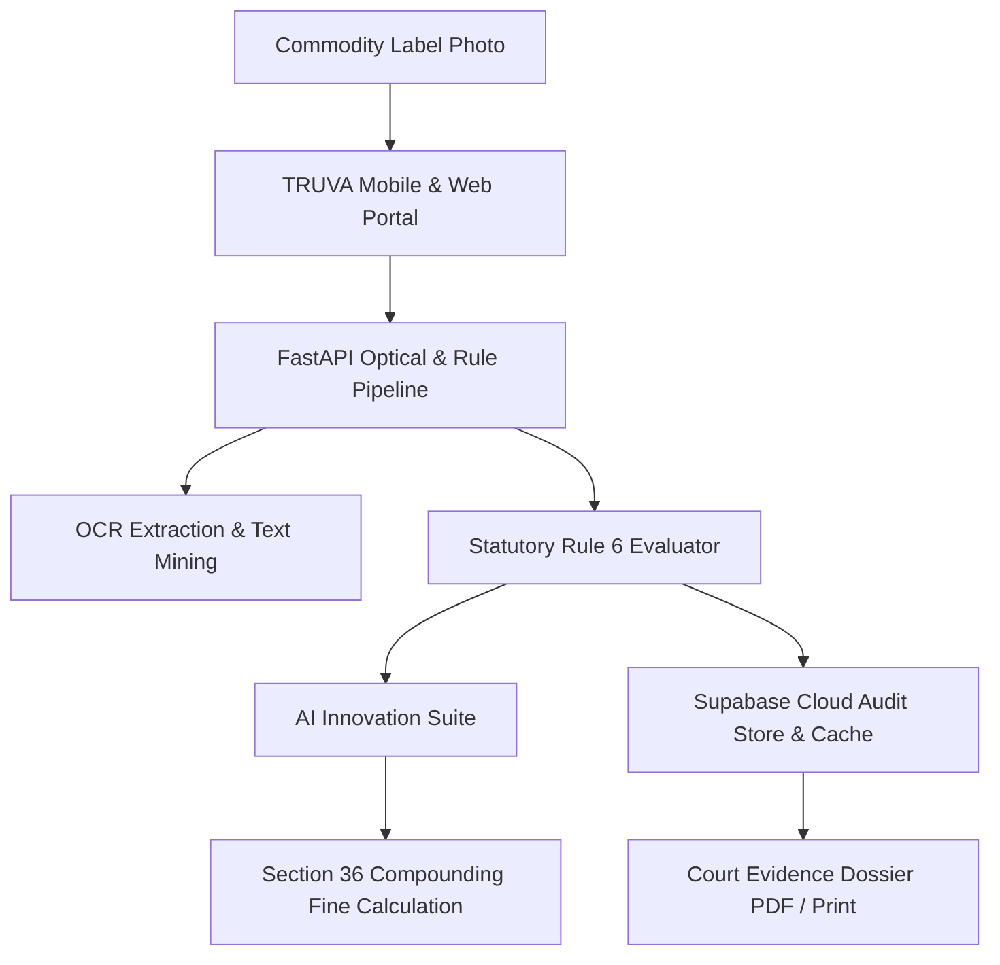

<div align="center">

# ⚖️ TRUVA • राष्ट्रीय विधिक मापविज्ञान पोर्टल
### **Next-Gen AI-Powered Statutory Metrology & Fair Commerce Enforcement Platform**

[](https://github.com/anshjaiswal2911-tech/TRUVA-)
[](https://consumeraffairs.nic.in/)
[_&_11-15803d?style=for-the-badge&logo=checkmarx&logoColor=white)](https://consumeraffairs.nic.in/)
[](https://react.dev/)
[](https://fastapi.tiangolo.com/)
[](https://tailwindcss.com/)
[](https://capacitorjs.com/)

<br/>

> **"Safeguarding 1.4 Billion Consumers with Real-Time Legal Metrology Label Verification, AI OCR Ingestion, and Court-Ready Enforcement Dossiers."**

[🌐 Live Presentation Web Portal](https://circus-marketing-teaching-src.trycloudflare.com/) • [📱 Mobile App Experience](https://circus-marketing-teaching-src.trycloudflare.com/?view=mobile) • [📑 Key Features](#-core-capabilities--modules) • [🚀 Quick Start](#-quick-start--installation)

---

</div>

<br/>

## 🎯 Executive Problem Statement

In India, **over 80% of consumer packaging complaints** relate to non-adherence to the **Legal Metrology (Packaged Commodities) Rules, 2011**:
- ❌ **Missing Unit Sale Price (USP)** making consumer price comparison impossible.
- ❌ **Hidden Shrinkflation** (reducing packet weight from 100g to 80g while keeping the ₹50 MRP identical).
- ❌ **Illegible font sizes** violating **Schedule II font-to-area minimums**.
- ❌ **Absence of complete manufacturer/packer physical addresses** and customer care channels.

**TRUVA** resolves this through an **automated multimodal audit suite** bridging **Statutory Enforcement Officers** and **Empowered Citizens (Jago Grahak Jago)**.

---

## 🌟 Visual Highlights & Screenshots

<div align="center">

| 🏛️ Enforcement Inspector Desk | 📱 Citizen Consumer Mobile App |
| :---: | :---: |
| Single-pane dashboard evaluating 8 Rule 6(1) declarations with compounding penalty calculator. | Clean Flutter-style mobile view with instant 1-tap NCH 1915 grievance filing. |

</div>

---

## ⚡ Core Capabilities & Modules

### 1. 🇮🇳 8-Point Statutory Declaration Engine (Rule 6)
- **Rule 6(1)(a):** Name & Complete Physical Address of Manufacturer / Packer / Importer.
- **Rule 6(1)(b):** Generic or Common Name of Commodity on the Principal Display Panel (PDP).
- **Rule 6(1)(c):** Net Quantity in standard metric units (`g`, `kg`, `ml`, `l`).
- **Rule 6(1)(d):** Month & Year of Manufacture, Packing, or Import.
- **Rule 6(1)(e):** Maximum Retail Price (MRP) with mandatory `(Inclusive of all taxes)`.
- **Rule 6(11):** Unit Sale Price (USP) declared in ₹/g or ₹/ml.
- **Rule 6(1)(n):** Consumer Care phone, email, and designated grievance officer contact.
- **Country of Origin:** Mandatory declaration for domestic & imported commodities.

---

### 2. 🧪 SIH 2026 Advanced AI Innovation Suite
Integrated into every inspection record:
- 📉 **Shrinkflation & Deceptive Packaging Detector:**  
  Historical volume-to-price tracker revealing hidden gram reductions.
- 📐 **Rule 9 Geometric Font Analyzer:**  
  Measures PDP surface area and validates whether printed font heights satisfy Schedule II standards.
- ⚖️ **Section 39 Compounding Notice Generator:**  
  Generates automated official **Form A Show Cause & Seizure memos** for judicial presentation.
- 🔐 **Cryptographic Evidence Audit Trail:**  
  Tamper-proof SHA-256 hashes linking original photos, OCR bounding boxes, and inspector timestamps.

---

### 3. 👥 Dual Operational Modes

| Feature | 🏛️ Enforcement Inspector | 🛍️ Citizen / Consumer |
| :--- | :--- | :--- |
| **Theme & UI** | Government Forest Green & Slate | Clean Royal Blue & Emerald |
| **Focus** | Rule 6/11 audit, compounding fines, Section 36 | Fair pricing, best before dates, USP value |
| **Decisions** | Official `COMPLIANT` vs `NON-COMPLIANT` | `Safe to Buy` vs `Warning Flag` |
| **Actions** | Generate seizure notice, export PDF dossier | File 1-click NCH 1915 complaint, compare brands |

---

## 🛠️ Architecture & Tech Stack



- **Frontend:** React 19, TypeScript, Tailwind CSS v4, Lucide & Google Material Symbols.
- **Mobile Engine:** Capacitor 7 (Android Java & iOS Swift bridging).
- **Backend Services:** FastAPI, Python 3.12+, Uvicorn, Tesseract / TrOCR / PaddleOCR.
- **Persistence & Cache:** Supabase Cloud PostgreSQL + Local IndexedDB Offline Cache.
- **Tunneling & Distribution:** Cloudflare Argo Tunnel for public demonstrations.

---

## 📱 Mobile-First Native Experience

TRUVA is engineered for seamless field enforcement:
- 📲 **Zero Desktop Artifacts:** When viewed on phones or via `?view=mobile`, all grids collapse to smooth, single-column touch cards.
- ⚡ **Direct Authentication:** Instant entry to role selector without bloated marketing landing pages.
- 📴 **100% Offline Capability:** Cached inspection records remain readable in remote wholesale mandis and warehouses without network.
- 📳 **Haptic Feedback:** Tactile confirmation on scanning, decision selection, and filter switches.

---

## 🚀 Quick Start & Installation

### 1. Clone Repository
```bash
git clone https://github.com/anshjaiswal2911-tech/TRUVA-.git
cd TRUVA-
```

### 2. Frontend Setup
```bash
# Install node packages
npm install

# Start Vite dev server on port 3000
npm run dev
```

### 3. Backend Setup
```bash
cd backend
python3 -m venv venv
source venv/bin/activate
pip install -r requirements.txt

# Start FastAPI server on port 8000
uvicorn api:app --host 0.0.0.0 --port 8000 --reload
```

### 4. Build Native Mobile Apps
```bash
# Build web assets
npm run build

# Sync with Android Studio
npx cap sync android
npx cap open android

# Sync with Xcode (macOS)
npx cap sync ios
npx cap open ios
```

---

## ⚖️ Statutory Compounding Schedule (Section 36)

| Offense Description | Statutory Provision | 1st Violation Penalty | Subsequent Offense |
| :--- | :--- | :--- | :--- |
| **Missing Rule 6 Declarations** | Section 36(1) | ₹25,000 | ₹50,000 + Imprisonment |
| **Short Net Quantity Deficit** | Section 36(2) | ₹10,000 - ₹50,000 | Compounding Trial |
| **Overcharging above printed MRP** | Section 36(1) | ₹2,000 - ₹5,000 per pack | License Action |
| **Deceptive Non-Standard Package** | Section 18 | Notice to Show Cause | Seizure under Sec 15 |

---

## 🤝 Contributing & Team

Developed with ❤️ for **Smart India Hackathon 2026** by Team **TRUVA**:
- **Rajiv Jha** — Architecture & Backend Pipelines
- **Priyanjali Jaiswal** — UI/UX Design & Frontend Systems
- **Ansh Jaiswal** — Mobile Engineering & ML Rule Evaluators

---

<div align="center">

**Department of Consumer Affairs • Ministry of Consumer Affairs, Food & Public Distribution • Government of India**

[](https://github.com/anshjaiswal2911-tech/TRUVA-)

</div>
